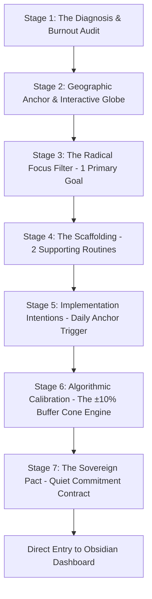
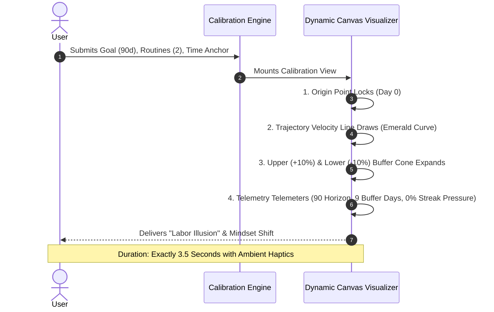

# Deep Research & UI/UX Architecture: The Onboarding System
**For The Improvement System (TIS) / Kinetic**
*Synthesized from Empirical Behavioral Science (Irrational Labs, Headspace, Grit, WHOOP), 1,460 Mobile Onboarding Flow Benchmarks, and TIS Core Brand Invariants.*

---

## 1. Executive Summary & Behavioral Thesis

### 1.1 The Behavioral Reality of Onboarding in Performance Apps
Standard onboarding approaches in habit and self-improvement apps fail because they treat onboarding as an administrative data-capture form or a generic tutorial. In contrast, behavioral economic research (notably from Dan Ariely’s *Irrational Labs*, *Kovalee*, and studies of top-grossing apps across 1,460 flows) establishes a fundamental truth:

> **"The onboarding questionnaire is not asking for user data. Asking is the psychological intervention itself. The questionnaire is the commitment mechanism, not an administrative intake form."**

### 1.2 Key Empirical Benchmarks
- **The Idiosyncratic Fit Effect (Headspace Case Study)**: Introducing a targeted personalization flow before recommending a course **doubled first-day action starts from 31.25% to 62.97%** compared to a control group without questions. When users perceive that a system was calibrated specifically to their constraints, adoption surges.
- **Precommitment & Implementation Intentions**: Prompting users to define a concrete *when, where, and what* trigger during onboarding increased overall app opens by **7.5%** and unique active open days by **4.0%**.
- **The Cognitive Chunking Law**: Splitting multi-input forms across paginated single-question screens **increases completion rates by 15%** while eliminating form intimidation (Baymard Institute & NN/G).
- **The "Sunk Cost" / IKEA Effect**: Users value outcomes significantly more when they invest effort into configuring the parameters of their system.

---

## 2. Core Brand Invariants & Guardrails for TIS Onboarding

The Improvement System has distinct, non-negotiable architectural constraints defined in `AGENTS.md`. Every question and UI component in this onboarding flow must strictly adhere to these invariants:

| Brand Invariant | Meaning for Onboarding | Forbidden Anti-Patterns |
| :--- | :--- | :--- |
| **Strict Constraint: 1 Focus + 2 Routines** | Onboarding must physically prevent over-ambition. Users cannot enter 5 goals; the system forces them to pick exactly ONE 90-day North Star and TWO supporting routines. | Never allow open-ended task dumps, endless habit pickers, or multi-goal setups. |
| **The Signature $\pm 10\%$ Buffer Cone** | The questionnaire must introduce the mathematical buffer cone (9 flexible buffer days over a 90-day horizon) as a structural feature that absorbs life disruptions. | Never frame missing a day as a "broken streak", "failure", or "streak reset". |
| **Anti-Streak / Anti-Attendance** | TIS does not measure unbroken attendance; it measures **deterministic trajectory velocity** and **commitment follow-through**. | Never introduce streak flame counters, streak preservation alerts ("Don't break your streak!"), or guilt triggers. |
| **No RPG Gamification** | TIS is a high-precision personal operating system for serious operators. | No XP bars, leveling, avatars, coin drops, fantasy hunter ranks, or confetti bursts. |
| **Neoskeuomorphic Materiality** | Deep Obsidian canvas (`#090D16`), liquid frosted glass (`backdrop-blur-xl`), 1px hairline boundary strokes, and Emerald (`#10B981`) kinetic energy. | Flat, borderless white screens or muddy 2012 drop shadows. |
| **Local-First Privacy** | All inputs are stored client-side in encrypted browser/device storage. | Forcing email/password authentication or OAuth upfront before calibration. |

---

## 3. The 7-Stage Behavioral Questionnaire Architecture

The onboarding flow is structured into a 7-stage progressive funnel designed to transition the user from passive curiosity to an active, sovereign commitment.



---

### Stage 1: The Burnout Audit (Confronting Streak Failure)
- **Objective**: Expose the fatal flaw of conventional streak apps and validate the user's past frustration. Creates immediate resonance and positions TIS as an adult, math-driven system.
- **Question Screen**:
  - **Eyebrow**: `DIAGNOSTIC • STEP 1 OF 7`
  - **Heading**: *"What usually causes your self-improvement routines to break?"*
  - **Subtext**: *"Most systems demand unbroken daily perfection. When life happens, you miss one day, the streak resets to zero, and you abandon the entire goal."*
- **Interaction Model**: Single-select vertical cards (large hit-areas, $\ge 56\text{px}$ height).
- **Options**:
  1. **"The Streak Guilt Trap"**: *Missed one day, lost my streak, felt discouraged, and quit.*
  2. **"Cognitive Overload"**: *Tried to change 5 habits at once and burned out in two weeks.*
  3. **"Vague Ambition"**: *Had general goals without a deterministic mathematical trajectory.*
  4. **"Rigid Schedules"**: *Life disruptions (travel, sickness, deadlines) destroyed my routine.*
- **System Response / Payoff Line**:
  *(Upon selection)*: A subtle emerald status indicator appears: *"Understood. TIS replaces fragile streaks with a $\pm 10\%$ mathematical buffer cone. Missed days are absorbed, not penalized."*

---

### Stage 2: Geographic Calibration & Interactive Globe
- **Objective**: Calibrate the user's temporal anchor (timezone, diurnal circadian rhythm, and daily closure schedule) while providing an immersive, tactile entry into the application.
- **Question Screen**:
  - **Eyebrow**: `TEMPORAL ANCHOR • STEP 2 OF 7`
  - **Heading**: *"Where are you operating from?"*
  - **Subtext**: *"Calibrates your local day cycle, morning focus window, and daily closure cadence. Stored strictly in local encrypted storage."*
- **The UI Component Architecture (Search List + Interactive 3D Globe)**:
  1. **Top Search Combobox**:
     - An obsidian glass input field: `[ Search country or region... ]` with a country search dropdown.
     - Auto-detects local browser timezone as a recommended chip (e.g. `📍 Detected: London, United Kingdom (UTC+0)`).
  2. **Interactive Tactile Globe**:
     - Rendered directly below the search bar inside an elevated obsidian card.
     - A dark obsidian glass sphere with glowing emerald coordinate meridians and continent outlines.
     - **Interactivity**: Users can freely spin/rotate the globe with their thumb or cursor. Tapping any continent/country auto-selects that region and drops a glowing emerald radar beacon pin.
     - **Bidirectional Sync**: Selecting a country from the dropdown smoothly rotates the globe to that coordinate point. Tapping a location on the globe updates the dropdown.
  3. **Calibrated Telemetry Readout**:
     - Below the globe, a clean HUD displays:
       - `Region`: *Berlin, Germany (Central European Time)*
       - `Timezone Offset`: *UTC +1*
       - `Daily Closure Cadence`: *Active (Midnight Reset aligned to your local solar clock)*

---

### Stage 3: The Radical Focus Filter (The 1 Primary Focus)
- **Objective**: Enforce the core constraint of TIS: **1 Primary Focus for the next 90 days**.
- **Question Screen**:
  - **Eyebrow**: `NORTH STAR • STEP 3 OF 7`
  - **Heading**: *"What is your single non-negotiable focus for the next 90 days?"*
  - **Subtext**: *"Ruthless prioritization. You cannot chase three priorities at once. One high-leverage objective that changes your trajectory."*
- **Interaction Model**: Dual-mode input: Quick-select category chips or bespoke input field with character limit ($80\text{ chars}$).
- **Categorical Archetypes**:
  - `Physical / Athletic`: *"Build foundational 5-mile aerobic endurance & mobility"*
  - `Professional / Engineering`: *"Ship production MVP and acquire first 100 paid users"*
  - `Intellectual / Creative`: *"Read, annotate, and synthesize 12 foundational books"*
  - `Financial / Capital`: *"Eliminate all consumer debt and accumulate 6-month buffer"*
- **The Guardrail Check**: If the user tries to type multiple goals joined by "and" (e.g. *"Get shredded and launch a SaaS and learn French"*), the system provides an inline gentle constraint nudge:
  > *"TIS Principle: Multi-focus leads to zero velocity. Split them into future 90-day cycles. Pick the lead domino right now."*

---

### Stage 4: The Scaffolding (Exactly 2 Supporting Routines)
- **Objective**: Establish the daily operational engine that powers the Primary Goal without exceeding cognitive bandwidth.
- **Question Screen**:
  - **Eyebrow**: `SCAFFOLDING • STEP 4 OF 7`
  - **Heading**: *"Select exactly 2 daily routines that directly feed this goal."*
  - **Subtext**: *"Not 5. Not 10. Exactly two non-negotiable daily actions. If these two happen, your trajectory is guaranteed."*
- **Interaction Model**: Multi-select pill cards with strict counter constraint `(Selected: X / 2)`.
  - Once 2 items are selected, remaining items dim slightly (`opacity-40`).
  - Next button activates with a tactile spring state.
- **Curated Options (Dynamically filtered by Stage 3 Category)**:
  - *For Athletic*: `[ ] 45-min Zone 2 Cardiovascular Execution` / `[ ] 8 Hours Sleep & Recovery Window` / `[ ] Daily 15-min Joint Mobility Routine`
  - *For Engineering*: `[ ] 90-min Uninterrupted Deep Work Block` / `[ ] Daily Production Code Commit` / `[ ] 1 Cold Customer Outreach Conversation`
  - *Custom Action*: `[ + Define Custom Routine ]` (inline concise input).

---

### Stage 5: Implementation Intentions & Daily Anchor
- **Objective**: Overcome the intention-action gap by anchoring execution to a specific contextual trigger (Irrational Labs research: $+7.5\%$ opens, $+4\%$ active days).
- **Question Screen**:
  - **Eyebrow**: `EXECUTION ANCHOR • STEP 5 OF 7`
  - **Heading**: *"When and where will your daily focus block take place?"*
  - **Subtext**: *"Habits without spatial and temporal triggers exist only in your imagination."*
- **Interaction Model**: Two responsive segmented selectors.
  - **Time Window**:
    - `[ Dawn / Pre-Work (06:00 - 08:30) ]`
    - `[ Midday / Lunch Reset (12:00 - 13:30) ]`
    - `[ Evening Deep Session (18:00 - 20:30) ]`
  - **Contextual Trigger**:
    - *"Immediately after morning coffee"*
    - *"Directly upon closing work laptop"*
    - *"Before checking digital communications"*

---

## 4. Deep-Dive on Stage 6 (Algorithmic Calibration): What It Does & What It's For

Stage 6 (formerly Stage 5) is the **psychological and experiential turning point** of the entire onboarding journey. It is neither a survey question nor a static loading screen.



### 4.1 What Does It Physically Do?
1. **Takes the User's Real Parameters**:
   - Primary Focus (Goal duration: 90 days).
   - 2 Supporting Daily Routines.
   - Selected Anchor Time and Local Timezone.
2. **Executes a Live 3.5-Second Mathematical Simulation**:
   - The UI darkens slightly into full focus mode.
   - A central coordinate plane appears with an origin point at **Day 0**.
   - A kinetic emerald vector line traces upward across a 90-day timeline representing **Required Velocity**.
   - Two translucent glowing emerald boundary lines expand above ($+10\%$) and below ($-10\%$) the trajectory, creating a **visible mathematical cone of tolerance**.
3. **Surfaces Hard Telemetry Outputs**:
   - `Horizon`: **90 Days**
   - `Goal Steps`: **90 Discrete Daily Units**
   - `Buffer Capacity`: **9 Flexible Days (10% Tolerance)**
   - `Streak Counter`: **Disabled (Zero streak anxiety)**
   - `Mathematical Resilience Index`: **Optimized**

---

### 4.2 What Is It For? (The Behavioral Psychology & Strategic Purpose)

Stage 6 accomplishes four critical psychological objectives that conventional apps completely miss:

#### 1. The Labor Illusion (Harvard Business School Research)
- **The Empirical Principle**: In landmark research by Buell & Norton (HBS), users who observe software "working" on their behalf (demonstrating computational effort and calculation) value the resulting output significantly more than when the exact same output is served instantaneously.
- **In TIS**: An instantaneous jump from questionnaire to dashboard makes the app feel like a toy. The 3.5-second calibration communicates: *"A serious mathematical algorithm is modeling your personal trajectory."*

#### 2. The IKEA Effect & Idiosyncratic Fit
- Because the trajectory line and cone are calculated directly from their specific inputs, the user experiences intense psychological ownership. The system is no longer "an app someone else made"; it is **their personal trajectory engine**.

#### 3. Eradicating the "What-the-Hell" Effect (The Anti-Streak Breakthrough)
- In behavioral psychology, the *"What-the-Hell Effect"* occurs when a person breaks a strict rule (like missing day 14 of a 14-day streak) and concludes: *"I've failed, so what the hell, I might as well quit completely."*
- **Stage 6 rewires this mental model before the user ever sees the dashboard**:
  - The visual cone explicitly shows them that **the trajectory is not a razor-thin fragile line**.
  - It proves visually that missing a day is structurally anticipated by the 9-day buffer.
  - The user understands: *"Even if life disrupts me next week, I am still inside the cone. I am still succeeding."*

#### 4. The Transition from Casual User to Sovereign Operator
- Most habit apps feel like entertainment or social games. Stage 6 shifts the tone into a calibrated flight instrument or financial terminal. It sets the serious, quiet, focused demeanor of The Improvement System.

---

### Stage 7: The Sovereign Pact (Quiet Commitment Contract)
- **Objective**: Establish cognitive dissonance through a formal, self-directed commitment.
- **Screen Architecture**:
  - **Eyebrow**: `THE SOVEREIGN PACT • STEP 7 OF 7`
  - **Heading**: *"You are ready. Here is your operational contract."*
  - **The Tactile Parchment Card** (`bg-slate-900/80`, `border-emerald-500/30`, `backdrop-blur-xl`):
    ```
    OPERATOR: [User Name / Local Device ID]
    REGION: [Selected Country & Local Timezone]
    PRIMARY FOCUS: [User's Goal from Step 3]
    SUPPORTING ENGINES: [Routine 1] + [Routine 2]
    HORIZON: 90 Days (Target: [Calculated Date])
    TOLERANCE: 9 Flex Days Absorbed without Penalty
    METRIC: Trajectory Velocity within Buffer Cone
    ```
  - **Affirmation Button**: A tactile press-and-hold button (requires $1.2\text{s}$ hold to prevent mindless clicking):
    - Text: `Press & Hold to Initialize Trajectory`
    - Feedback: Expanding emerald radial glow under thumb, gentle haptic tick on completion.

---

## 5. UI/UX Component & Layout Specification

### 5.1 Layout Archetype & Viewport Architecture
- **Archetype**: **Single-Column Vertical Flow** (Baymard Institute standard; zero gaze distraction).
- **Container Constraint**: `max-w-md mx-auto` (mobile-first ergonomics, centered on desktop).
- **Padding & Grid**: Aligned strictly to the **8pt spatial system** (`p-4 sm:p-6`, `space-y-6`).

```
+-------------------------------------------------------------+
| [ <- Back ]             [ === Progress: 2/7 === ]    [ Skip ] |  <- 44px Header
|-------------------------------------------------------------|
| Eyebrow: TEMPORAL ANCHOR • STEP 2 OF 7                      |
| Heading: Where are you operating from?                      |  <- Typography (AAA Contrast)
| Subtext: Calibrates your local day cycle...                 |
|                                                             |
| +---------------------------------------------------------+ |
| | [ Search country or region...                         ] | |  <- Glass Combobox
| +---------------------------------------------------------+ |
|                                                             |
| +---------------------------------------------------------+ |
| |                    [ 3D TACTILE GLOBE ]                 | |  <- Rotatable Globe
| |       Emerald coordinates on deep obsidian sphere       | |
| |              [ Glowing Emerald Beacon Pin ]             | |
| +---------------------------------------------------------+ |
|                                                             |
| [ Telemetry: Berlin, Germany • UTC+1 • Midnight Reset ]     |  <- Ambient Status
|                                                             |
| [ Bottom Anchor: Primary CTA "Confirm Location ->" ]        |  <- Natural Thumb Zone
+-------------------------------------------------------------+
```

### 5.2 Materiality & Styling Tokens (Tailwind & CSS)
- **Canvas Backdrop**: `bg-[#080C14]` (rich, deep obsidian with 2% blue tint; never raw black `#000000`).
- **Surface Elevation Cards**:
  ```tsx
  className="relative rounded-2xl border border-white/10 bg-slate-900/60 p-4 
             backdrop-blur-xl transition-all duration-200 
             shadow-[inset_0_1px_1px_0_rgba(255,255,255,0.12),0_8px_20px_-4px_rgba(0,0,0,0.5)] 
             hover:border-white/20 active:scale-[0.98] cursor-pointer"
  ```
- **Selected State**:
  ```tsx
  className="border-emerald-500/60 bg-emerald-950/20 
             shadow-[inset_0_1px_1px_0_rgba(16,185,129,0.3),0_0_24px_-4px_rgba(16,185,129,0.25)]"
  ```
- **Progress Stepper**: Segmented progress bar (7 micro-bars separated by 4px gaps) rather than a continuous line, providing clear discrete chunking.

---

## 6. Summary Matrix: The Complete 7-Stage TIS Onboarding Funnel

| Stage | Step Name | Primary User Action | Psychological Mechanism | UI Component |
| :---: | :--- | :--- | :--- | :--- |
| **1** | **Burnout Audit** | Select primary reason for past routine failure | Empathy, Cognitive Validation | Single-select cards with dynamic payoff note |
| **2** | **Temporal Anchor** | Search list or tap country on 3D Globe | Reality Grounding, Circadian Sync | Interactive 3D Obsidian Globe + Combobox |
| **3** | **North Star** | Input or select 1 Primary Focus for 90 days | Radical Constraint, Cognitive Relief | Text input + Inspirational category chips |
| **4** | **Scaffolding** | Select exactly 2 daily supporting routines | Chunking, Cognitive Capacity Limit | Counter-gated multi-select chips `(X/2)` |
| **5** | **Execution Anchor** | Select time window and contextual habit trigger | Implementation Intentions | Responsive 3-segment time selector |
| **6** | **Calibration** | Observe dynamic mathematical trajectory generation | Labor Illusion, Anti-Streak Rewiring | Glowing dynamic buffer cone visualizer |
| **7** | **Sovereign Pact** | Press & hold to sign operational contract | Cognitive Dissonance, Identity Buy-in | Tactile contract card + 1.2s press-and-hold CTA |
